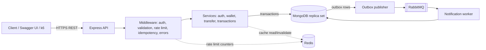

# LedgerLite — Milestone 0: Requirements and Design

> LedgerLite is a **simulated INR demo wallet**. No real money, cards, banks or payment gateways. All funding is "demo funding", gated by configuration.

Workspace inspected: it was **empty** (no existing files to preserve or conflict with).

---

## 1. Goals and non-goals

**Goals:** register/login, view balance, demo funding, wallet-to-wallet transfers, paginated history, transaction detail; correct money handling; idempotent transfers; tested, documented, containerised, deployed, load-tested (with real measurements).

**Non-goals:** real payments, KYC, refunds/reversals, multi-currency, TypeScript, microservices, anything UI-heavy before the backend is solid.

---

## 2. Key design decisions

| # | Decision | Why | Alternative rejected |
|---|----------|-----|----------------------|
| 1 | Money = **integer paise** (`Number`, capped) | Floats can't represent 0.1 exactly; integers are exact. Caps keep values far below 2^53 | Floats; Decimal128 (heavier, unnecessary at our scale) |
| 2 | **CommonJS** (`require`) everywhere | One module system, least config friction with Jest | ESM (more setup for beginners) |
| 3 | **Layered structure**: routes → controllers → services → models | Business rules (transfer logic) live in services, easy to test | Fat controllers |
| 4 | **MongoDB multi-document transactions** for transfers | Debit, credit, ledger entries and outbox row commit or fail together | Sequential updates (can leave half-done transfers) |
| 5 | **Replica set required** | Mongo transactions don't work on standalone servers. Dev options: Atlas free cluster, or local single-node replica set in Docker | Silently falling back to non-atomic updates (forbidden) |
| 6 | **Conditional balance update** (`balance >= amount` in the update filter) | Atomic check-and-debit prevents overspending under concurrency | Read-then-write (race condition) |
| 7 | **Double-entry ledger**: every transaction has debit + credit entries summing to zero | Auditable; balances can be re-derived and verified | Only updating balances |
| 8 | **Idempotency-Key** stored in its own collection with a unique index | DB enforces uniqueness even under simultaneous retries | In-memory/Redis-only check (not authoritative) |
| 9 | **Outbox pattern** for RabbitMQ (Milestone 7) | Event is saved in the same DB transaction as the transfer, so no lost/phantom notifications | Publishing directly after commit (can lose events on crash) |
| 10 | **Redis is a cache only** | DB stays the source of truth; cache failure must never break correctness | Trusting cached balances for transfer decisions |

### Decisions I need you to confirm (see Section 9)
- Recipient identified by **email**.
- Demo funding uses a **system "demo faucet" wallet** as the counter-party so the ledger still balances.
- Validation library: **Joi** (alternative: zod).

---

## 3. Architecture



Build order: API + MongoDB first (Milestones 1–4), then Redis (6), RabbitMQ (7). Redis and RabbitMQ are never exposed publicly.

### Transfer request flow (core of the project)
1. Client sends `POST /transfers` with JWT and `Idempotency-Key`.
2. Auth middleware verifies the token; validation checks the body (integer paise, in range, valid recipient).
3. Idempotency check: insert key record (unique index). If it exists with the same payload hash → replay stored response; different hash → `422`.
4. Start a MongoDB transaction:
   - Conditionally debit sender (`balance >= amount`) — fails cleanly if insufficient.
   - Credit recipient.
   - Insert transaction record plus two ledger entries (debit/credit).
   - Insert outbox event (Milestone 7).
5. Commit, store the response against the idempotency key, invalidate cached balances, return `201`.
6. On transient transaction errors, retry a small bounded number of times.

---

## 4. Proposed folder structure

```
ledgerlite/
├── src/
│   ├── app.js                # Express app (no listen) — easy to test
│   ├── server.js             # starts the server
│   ├── config/               # env loading and validation, db connection
│   ├── models/               # Mongoose schemas
│   ├── routes/               # URL → controller mapping
│   ├── controllers/          # HTTP in/out only
│   ├── services/             # business logic (transfers, wallets, auth)
│   ├── middleware/           # auth, validate, idempotency, rateLimit, errorHandler
│   ├── validators/           # request schemas
│   ├── utils/                # AppError, money helpers, logger
│   ├── queue/                # RabbitMQ publisher/consumer (Milestone 7)
│   └── cache/                # Redis helpers (Milestone 6)
├── tests/                    # unit/ and integration/
├── docs/                     # plan, API docs, diagrams
├── load-tests/               # k6 scripts (Milestone 9)
├── .github/workflows/        # CI (Milestone 8)
├── Dockerfile
├── docker-compose.yml
├── .env.example
├── .gitignore
└── README.md
```

---

## 5. Data model

All amounts are integer paise. All collections have `createdAt`/`updatedAt`.

**users**
- `_id`, `name`, `email` (unique, lowercase), `passwordHash`

**wallets** (one per user, plus one system faucet wallet)
- `_id`, `userId` (unique; null for system wallet), `balance` (int paise, ≥ 0 for users), `currency` ("INR"), `type` ("USER" | "SYSTEM_DEMO_FAUCET"), `version`

**transactions**
- `_id`, `reference` (unique, e.g. `TXN-<ulid>`), `type` ("TRANSFER" | "DEMO_FUNDING"), `status` ("PENDING" | "SUCCEEDED" | "FAILED"), `amount`, `fromWalletId`, `toWalletId`, `initiatedBy`, `idempotencyKey`, `note`
- Indexes: `reference` unique; `(fromWalletId, createdAt)` and `(toWalletId, createdAt)` for history.

**ledger_entries**
- `_id`, `transactionId`, `walletId`, `direction` ("DEBIT" | "CREDIT"), `amount`, `balanceAfter`
- Invariant: for each transaction, sum(credits) − sum(debits) = 0.

**idempotency_keys**
- `_id`, `userId`, `key`, `requestHash`, `status` ("IN_PROGRESS" | "COMPLETED"), `responseStatus`, `responseBody`, `transactionId`, `expiresAt` (TTL index)
- Unique index on `(userId, key)`.

**outbox_events** (Milestone 7)
- `_id`, `type`, `payload`, `status` ("PENDING" | "PUBLISHED"), `attempts`, `nextAttemptAt`, `transactionId`

**notifications** (Milestone 7)
- `_id`, `eventId` (unique, for idempotent processing), `userId`, `message`, `readAt`

**Overspending rule:** user wallets are never allowed below zero (enforced by the conditional update, plus a schema `min: 0`). The system faucet wallet is the only one allowed to go negative.

---

## 6. API contract (v1, base path `/api/v1`)

Errors use one shape: `{ "error": { "code": "INSUFFICIENT_FUNDS", "message": "...", "details": [] } }`.

| Method | Path | Auth | Purpose | Success | Key errors |
|--------|------|------|---------|---------|------------|
| GET | `/health` | no | liveness (DB/Redis status later) | 200 | — |
| POST | `/auth/register` | no | create user + wallet | 201 | 400 validation, 409 email exists |
| POST | `/auth/login` | no | returns JWT | 200 | 401 invalid credentials |
| GET | `/me` | yes | current user | 200 | 401 |
| GET | `/wallet` | yes | balance (paise + formatted ₹) | 200 | 401 |
| POST | `/wallet/demo-funds` | yes | add demo funds (only if `DEMO_MODE=true`) | 201 | 403 demo disabled, 400 amount |
| POST | `/transfers` | yes + `Idempotency-Key` | transfer to another user by email | 201 (200 on replay) | 400 invalid, 404 recipient, 409 in-progress duplicate, 422 key reused with different payload / insufficient funds / self-transfer |
| GET | `/transactions?page=&limit=` | yes | own history, newest first, limit ≤ 50 | 200 | 401 |
| GET | `/transactions/:id` | yes | detail, only if you are a party | 200 | 404 (also for others' transactions, avoids leaking existence) |
| GET | `/docs` | no | Swagger UI (Milestone 4) | 200 | — |

**Transfer body:** `{ "toEmail": "bob@example.com", "amountPaise": 25000, "note": "lunch" }`

**Amount rules:** integer, ≥ 100 paise (₹1), ≤ 1,00,00,000 paise (₹1,00,000) per transfer; demo funding capped per call and by total balance.

**Status semantics:** `SUCCEEDED` = committed; business rejections (insufficient funds, self-transfer) return an error and move no money; `PENDING` is reserved for async flows and not used by transfers in v1.

---

## 7. Security baseline
bcrypt (cost 12), JWT with expiry and secret from env, Helmet, CORS allowlist, request size limits, rate limiting on auth routes (Redis-backed in Milestone 6), generic login error messages, no secrets in Git, `.env.example` only.

---

## 8. Roadmap

| M | Focus | Done when |
|---|-------|-----------|
| 0 | Design (this doc) | You approve the plan |
| 1 | Repo, Express, config, health, README, GitHub | `GET /health` works; first commit pushed |
| 2 | DB, auth, JWT, validation | Auth tests pass |
| 3 | Wallet, ledger, atomic transfers | Transfer tests pass on a replica set |
| 4 | Idempotency, concurrency, pagination, OpenAPI | Concurrency and replay tests pass |
| 5 | Optional React UI | Only if backend tests pass |
| 6 | Redis cache + rate limit | Stale-balance tests pass |
| 7 | RabbitMQ outbox worker | Idempotent event processing tested |
| 8 | Docker + GitHub Actions | CI green |
| 9 | EC2 deployment + k6 | Real, measured results recorded |

---

## 9. Questions for you
1. **MongoDB for development:** Atlas free cluster, or a local single-node replica set in Docker? (I suggest local Docker replica set for dev/tests, Atlas for the EC2 deployment.)
2. Which Node.js version do you have installed (`node -v`)? Is Docker installed (`docker --version`)? Do you have a GitHub account and Git configured?
3. OK with **Joi** for validation, **pino** for logging, and **recipient by email**?
4. OK with the **system faucet wallet** approach for demo funding?
